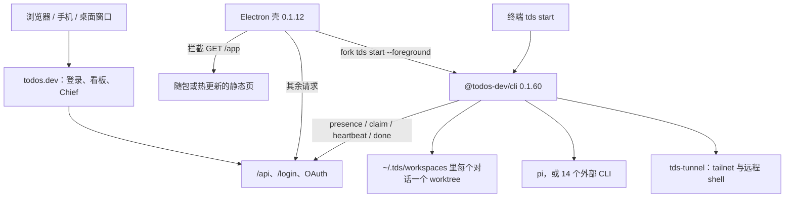

# Todos：托管工作台、本机执行器，以及为什么它不是可 fork 底座

研究日期：2026-10-08。材料是官方 Mac DMG 与 npm `@todos-dev/cli@0.1.60`，不是上游 git 仓库。没有登录、没有注册机器、没有跑真实任务。官方文档只用来对照客户端已经出现的协议，不把网页文案当成服务端实现。

## 1. 结论

**Todos 是一套托管控制面加上可安装的本机执行器，适合当产品参照，不能当可 fork 的底座。**人看到的看板、Chief、待办拆分和审批开关都在 `todos.dev`。本机只安装两样东西：Electron 桌面壳，以及名为 `tds` 的执行器。执行器向服务器报到、领取 step、在 git worktree 里跑一个 harness，再把结果交回去。克隆这两样得不到 Chief，也得不到一块可以自己部署的看板。

五件已经落到文件上的事：

1. 桌面壳版本是 `0.1.12`（`@tds/desktop`）。它把自己写成 web app 外面的 Electron 壳，窗口默认打开 `https://todos.dev/app`。`/app` 的静态页可以来自安装包或热更新包，`/api`、登录、OAuth 原样转到网络。见 `desktop/package.json` 的 `description`，以及 `installLocalApp`、`APP_URL`。
2. 「安装 runner」的包是 `@todos-dev/cli`，本次 `latest` 为 `0.1.60`，命令是 `tds`。两份 DMG 的 `Resources/machine/dist/index.js` 与 npm 包字节相同。壳用 `utilityProcess.fork` 跑 `tds start --foreground`，和终端里的 `tds start` 抢同一把 `~/.tds/daemon.json` 锁。
3. 执行器不编排团队。`PollClient.claimOnce` 向 `/api/machine/tasks/claim` 领一个 step；并发上限来自 presence 回包里的 `maxConcurrentTasks`。step 上如果带 `runtime`，就进 `EXTERNAL_RUNTIMES` 的 14 个外部 CLI 之一，否则走内置的 `@earendil-works/pi-coding-agent`。谁来当 Chief、如何拆 todo、派给哪个 agent，不在这个包里。
4. 执行器没有逐工具等人批准的 waiter。工具名单随 step 下来；外部 CLI 要么把原生审批关掉，要么把问人的请求自动拒绝。`remote_shell` 的文案写明 grant 在服务端、机器开关另算。只读回合结束后，`discardReadOnlyTurn` 用 `git reset --hard` 丢掉工作区改动，这是事后清场，不是执行前审批。
5. 可恢复的是这一台机器上的执行状态：会话 jsonl、对话分支 `tds/conv-<id>`、`/done` 的本地 outbox、启动时的 `/api/machine/recover`。看板、团队和模型密钥不在本机。合上笔记本之后，任务不会从这份客户端里迁走；文档说的平台机器也不在这个安装包里。

## 2. 拿到了什么

| 材料 | 身份 | 在仓库中的位置 |
|---|---|---|
| `Todos-arm64.dmg` / `Todos-x64.dmg` | 桌面 `0.1.12`，2026-10-08 | 未入库。URL 与 SHA-256 在 [todos-dev-reversed/README.md](../../todos-dev-reversed/README.md) |
| `@todos-dev/cli@0.1.60` | runner，`bin.tds = dist/index.js` | `todos-dev-reversed/cli/` |
| `app.asar` 的 main/preload sourcemap | 壳的 TypeScript | `todos-dev-reversed/desktop/recovered/` |

安装文档写的就是 `npm install -g @todos-dev/cli@latest` 然后 `tds start`（https://todos.dev/docs/install ，https://todos.dev/docs/cli）。桌面壳 `Resources/machine/package.json` 的 `name` 同样是 `@todos-dev/cli`、`version` 是 `0.1.60`。同 scope 的 `@todos-dev/cli-darwin-arm64` 等是 `tds-tunnel` 边车，描述写明由 CLI 自动安装。没有第二个候选被装进仓库。

`cli/dist/index.js` 是 esbuild 产物，13908 行，保留 `// src/....ts` 注释。`cli/module-index.json` 记录每个源文件的行号区间。下文函数名都在这个文件里，除非另写桌面路径。

直接依赖在运行时才加载：`@earendil-works/pi-coding-agent@1.0.0`、`@anthropic-ai/claude-agent-sdk@0.3.226`、`@modelcontextprotocol/sdk@1.32.1`、`undici@7.30.0`、`eventsource@4.1.1`。它们的实现没有入库。涉及它们内部如何过滤工具名的地方，下面会标成未决。

## 3. 产品边界

壳的源码把这件事写死了。`APP_URL` 默认 `https://todos.dev/app`。`installLocalApp` 只处理该源上 `GET /app` 的静态文件；其他请求，包括 `/api` 和 `/login`，交给 `passThrough`。注释写明 cookie、SameSite、CORS 都绑在 `https://todos.dev` 上，不能改成 `file://`。

因此：桌面应用不是第二套控制面。它是同一套网站的窗口，外加一台可以在本机跑构建的执行器。

## 4. Runner 如何安装、注册、连接

`startCommand` 是入口。未加 `--foreground` 时，它先 `ensureEnrolled`，再 `preflight` 打一次 `/api/machine/presence`，然后拉起带 `--supervisor` 的脱离进程，并把 pid 写入 `daemon.json`，`runner` 标成 `cli`。`--foreground` 不经 supervisor，直接 `runWorker`。已有活着的 daemon，或发现另一个带 `--foreground` 的 `dist/index.js`，都会拒绝再起一个，避免同一台机器两个 worker。

注册有两条，都在 `enroll.ts`：

| 路径 | 请求 | 写入 |
|---|---|---|
| 有浏览器 | `POST /api/machine/enroll/start`，然后每 2 秒 `POST /api/machine/enroll/poll`，最多约 3 分钟 | `saveEnrolled` |
| `--api-key` 加 `--team` | `POST /api/machine/enroll` | 同上 |

设备号来自 `getDeviceId`：`~/.tds/device.json` 里已有就复用，否则用 `sha256(hostname + 随机盐)` 的前 32 位十六进制，文件模式 `0600`。`tds logout` 清的是 `machine.json`，这份设备号按桌面壳注释会留下来，以便再次注册指回同一台机器。

`saveConfig` 把 `machineId`、`token`、`teamId`、`serverUrl` 写入 `~/.tds/machine.json`，模式 `0600`。默认服务器是 `https://todos.dev`，可用 `--server` 或 `TDS_SERVER` 覆盖。请求带 `Authorization: Bearer <token>`，另有版本头（`machineHeaders`）。

连上之后 `PollClient.start` 做四件事：每 20 秒 presence、接 `/api/machine/stream` 的 SSE（`WakeChannel`）、每分钟冲刷 done outbox、然后 `POST /api/machine/recover` 再进入领取循环。presence 上报负载、平台、架构、工作区目录、已安装的外部 runtime、隧道地址，以及 `TDS_RUNNER=desktop` 时的 `runner: "desktop"`。回包可以改 `maxConcurrentTasks`、下发 `execTargets` 和 `serveWanted`。HTTP 401 走 `handleRevoked`，进程以码 78 退出，桌面壳把这码当成注销（`restartDecision` 的 `terminal` 会 `clearConfig`）。

桌面壳不另写一套注册协议。`machine.enroll` 收的是网页已经换好的 `machineId` / `teamId` / `token`，用同一个 `saveConfig` 落盘，然后 `forkWorker`。若注册服务器的主机名和 `APP_ORIGIN` 不同，`foreignServer` 拒绝接管，避免这个壳用错服务器把 CLI 的注册写掉。用户点接管时，`takeOver` 先按 `tds stop` 的方式停掉外部 daemon，再在本进程里启动。注释写明：壳不会在启动时主动挤掉已经在跑的 CLI。

## 5. 任务、会话和多 agent

领取在 `claimOnce`。`POST /api/machine/tasks/claim`，body 只有当前 `load`。空结果且 SSE 健康时，`parkForWake` 最多停 45 秒；注释写这个上限必须短于服务端 60 秒的 stalled sweep，否则卡住的任务不会被重新排队。有 step 就放进 `runningTasks`。`mode === "branch_sync"` 走 `executeBranchSyncJob`，其余走 `executeStep`。

`executeStep` 里能看见的回合种类：

| `step` 上的标记 | 行为 | 函数 |
|---|---|---|
| `mode === "restore"` | 把 worktree 重置到检查点提交，并截断会话文件 | `executeRestore` |
| `mode === "compact"` | 只对内置 pi 会话做压缩；外部 runtime 直接回错误 | `executeCompact` |
| `step.runtime` 有值 | 查 `EXTERNAL_RUNTIMES` | 各 `execute*Step` |
| 都没有 | 内置 pi：`createAgentSession` | `createSession2` |

`EXTERNAL_RUNTIMES` 的键是：`claude-code`、`codex`、`grok-build`、`cursor`、`antigravity`、`devin`、`copilot`、`gemini-cli`、`omp`、`opencode`、`qwen-code`、`droid`、`cline`、`dsh`。每个条目提供 `installed`、`turn`、`restore`，多数还有 `usage`。二进制是用户机器上已安装的 CLI，不是随包拷贝。例如 Cursor 找的是 `cursor-agent` 或 `TDS_CURSOR_BIN`。presence 把 `installed()` 为真的名字报上去，服务端据此决定能不能把这种回合派到这台机器。本仓库没有看到服务端的选择代码。

工作区在 `prepareConversationWorkspace`。每个 `projectId` 有一份 `workspaces/<projectId>/repo` 的克隆；每个 `conversationId` 有一份 worktree，分支名 `tds/conv-<conversationId>`（`convBranch`）。已存在的 worktree 默认复用，不重复 fetch；`restore` 或 `freshBase` 才会再取分支。凭证来自 step 里的 `installationToken` 或 `workspace.remote`，经 `git config` 的 `insteadOf` 注入，不进命令行参数文本（`authConfig`）。推送凭证过期时，`makePushCredential` 再向 `/api/machine/tool/<stepId>` 要一次。

会话文件：

- 内置 pi：`~/.tds/chat-sessions/`（或 `TDS_CHAT_SESSIONS_DIR`）下的 jsonl，索引是 `index.json`。本机没有文件时，`hydrateFromUrl` 用 step 的 `sessionRestoreUrl` 拉一份再 `SessionManager.open`。回合结束把文件 gzip 后 PUT 到 `sessionBackupUrl`（`backupSession` / `uploadMirror`）。`truncateSessionToLeaf` 按 `sessionLeafEntryId` 截断，叶子找不到就清空到只剩头一行。
- 外部 CLI：各自的 `runtimeHome`（例如 `~/.tds/cursor-home`）里存会话映射，再用同一套 URL 做同步和备份。Cursor 走 ACP `session/load`，失败则 `session/new`。Codex 走 `thread/resume`，失败则 `thread/start`。压缩只实现在 pi 路径。

人的插话不是新开进程。`WakeChannel` 收到 `steer` 就 `pokeActiveHeartbeats`；心跳 `POST /api/machine/heartbeat/<stepId>` 的回包可以带 `steer` 数组和 `stop: true`。pi 路径把文本注入 `session.steer`；`interrupt` 会打断正在跑的 bash。心跳回 `stop` 时 `onSignal` 中止当前回合。外部 driver 各自把停止翻译成 `session/cancel`、`turn/interrupt` 或关掉查询。

多 agent 在这份代码里的含义是：一台机器可以同时跑多个 step（上限由服务器给，缺省按 1），每个 step 自带 `conversationId`、`agent`、`runtime`、`systemPrompt`。机器不归属某个 agent。`PollClient` 的日志把 step 记在 conversation 上，而不是记在 agent 名上。官网写 Chief 只拆分、不自己干活；客户端里没有 Chief 的循环，不能从这份包验证拆分、验收或「一个 Chief 对多个成员」的服务端状态机。

MCP 有两条，不要混。`connectMcpServers` 是这个回合去连团队配置的 MCP 服务器。`serveToolsBridge` 是相反方向：外部 CLI 需要 `git` / `push_branch` / remote tools 时，执行器再起一个 stdio MCP，名字是 `tds`，把这些工具暴露给那个 CLI。这不是「任意编辑器接管 Todos」，也不是 Todos 实现了 ACP 宿主。Cursor、Gemini、Cline、DSH、Devin、Grok 使用 ACP 或类 ACP 的 stdio，只是单个 harness 的传输。

## 6. 权限和审批

要分开三层。

**操作系统权限。** `installPermissions` 只允许窗口源申请麦克风、摄像头、通知、剪贴板和全屏。这和 agent 能不能跑命令无关。

**产品上的授权。** 执行器相信 step 里的名单。`remote_shell` 的 `NO_MACHINE_MSG` 写明：工具会出现在工具集里，是因为 grant 已经成立；机器侧还要有 Remote shell 开关，presence 用 `execTargets` 下发。`toolsBridge` 只把 `step.tools` 里的 `git` 和 `push_branch` 桥出去。团队密钥经 `step.secretEnv` 注入该回合的环境，不是写进 `machine.json`。谁有权打开这些开关，客户端没有实现；官方权限页把 grant 归到团队管理员或 Chief，本报告不把该页当成代码。

**harness 自己的审批对话框。** 执行器在无人值守路径上把它们关掉或拒绝，而不是转交窗口里的人：

| runtime | 代码里的处理 |
|---|---|
| claude-code | `permissionMode: "bypassPermissions"`，`allowDangerouslySkipPermissions: true`。只读或 ephemeral 时把 Write/Edit 放进 `disallowedTools` |
| codex | `approvalPolicy: "never"`，`sandbox: "danger-full-access"` |
| cursor | 启动参数 `--force acp`；独立 `cli-config.json` 里 `sandbox.mode = "disabled"`。`session/request_permission` 被 `declineAcpPermission` 拒绝；`cursor/ask_question` 回 skipped |
| grok-build | `--always-approve`；ACP 权限请求拒绝；`_x.ai/mcp/elicit` 回 decline |
| antigravity | `--dangerously-skip-permissions` |
| gemini-cli | `--approval-mode yolo`，注释写 YOLO 跑所有工具，仍来问的请求走 `acpAutoReply` 拒绝 |
| omp | `--yolo` |
| cline | `--auto-approve true`，其余 ACP 权限请求拒绝 |
| copilot | `session.permissions.setApproveAll` 为 true；仍出现的 `permission.requested` 回 `user-not-available` |
| devin | 将会话 mode 设为 `bypass`；该选项不存在时，注释写需要批准的工具会被拒绝 |
| opencode | 配置 `permission: { "*": "allow", question: "deny" }` |
| droid | `droid.request_permission` 回 cancel；`droid.ask_user` 回 cancelled |
| qwen-code | `permissions.deny` 列出问人、计划和定时类工具；只读回合再拒绝写文件 |
| dsh | 启动 `--profile acp`，`autoReply` 是 `acpAutoReply()`，也就是拒绝 `session/request_permission` |
| 内置 pi | `createAgentSession` 的 `tools` 来自 `step.tools` 加上 remote/MCP 名。bash、edit、`remote_shell` 作为 custom tool 被构造。没有本地审批回调 |

`acpAutoReply` 的默认动作是选 `reject_once` 或 `reject_always`，没有则 `cancelled`。所以「接了 ACP」在这里不等于「人可以在 ACP 权限请求上点允许」。

只读保护在回合末尾。`discardReadOnlyTurn` 看到 `step.readOnly` 且工作区有 `git status` 输出，就 `reset --hard` 并 `clean -fd`。Claude 路径的注释也写了：只读回合的 bash 仍然可用，工作区靠这次重置收回。重置失败只打警告。

推送和合并不是对话框。`push_branch` 只要在工具集里就会提交并推 `tds/conv-*`。回合结束的 `captureTurnCheckpoint` 还会按 `syncPush`、`landOnClean` 推送或落地到默认分支。这些开关在 step 的 workspace 上，由服务器随任务带来。

## 7. 状态放在哪里

本机根目录是 `TDS_HOME`，默认 `~/.tds`（`tdsDir`）。

| 路径 | 内容 | 谁写 |
|---|---|---|
| `machine.json` | 机器 id、token、团队 id、服务器 | `saveConfig`，模式 0600 |
| `device.json` | 设备指纹 | `getDeviceId`，logout 不删 |
| `daemon.json` | pid、启动时间、`runner` 为 `cli` 或 `desktop` | `writeDaemon` |
| `daemon.log` | 后台日志，超过 10MB 轮转 | `logPath` / `rotateLogIfBig` |
| `settings.json` | 持久化的 `workspacesDir` | `saveSettings` |
| `workspaces/<projectId>/repo` | 仓库克隆 | `ensureBaseRepo` |
| `workspaces/<conversationId>` | 该对话的 worktree | `prepareConversationWorkspace` |
| `chat-sessions/` | pi 会话 jsonl 与 `index.json` | `sessionStore` |
| `<runtime>-home/` | 各外部 CLI 的家目录和会话映射 | `runtimeHome` |
| `outbox/<stepId>.json` | 还没送到的 `/api/machine/done/<stepId>` | `deliverDone` |
| `agent-runtime/` | pi 的 agent 目录；启动时删掉遗留的 `auth.json`、`models.json` | `getPiRuntime` |

服务器上的状态从客户端只能看见接口，看不见存储：presence、claim、heartbeat、stream、done、tool、enroll。模型密钥随 step 的 `modelRuntime` 或外部 CLI 自己的登录到来。`getPiRuntime` 主动删除本地遗留的 `auth.json`，和文档「模型配置在网站、按任务下发」一致，但下发格式本身在 pi 的 `buildStepModelRuntime`，本报告没有把密钥样本写出来。

完成报告先落 outbox 再 POST。网络失败且错误可重试时留在磁盘，启动和每分钟各冲刷一次；超过 48 小时丢掉。`branch_sync` 收到 403 也保留。这样一次进程崩溃不会只靠内存记住「这步已经做完」。服务端是否把同一步只记账一次，客户端看不到。

7 天没碰的会话文件和孤儿 worktree 由 `cleanupStaleSessions`、`cleanupOrphanWorktrees` 删除。这是磁盘卫生，不是任务恢复。

## 8. 和宿主的边界

| 宿主 | 这份材料里的事实 |
|---|---|
| 桌面壳 | 窗口、自动更新、本地静态页、机器开关。更新分两路：electron-updater 从 `https://assets.todos.dev/desktop` 换壳；网页包从 `/app/desktop-manifest.json` 热替换（`updater.ts` 文件头注释） |
| 终端 CLI | 同一执行器。`tds upgrade` 按自己的安装路径升级，而不是按 `PATH` 上第一个 npm（`upgradeCommand`） |
| 编辑器 | 不嵌入。Cursor / Claude / Codex 等是子进程。Todos 自己的远程 MCP 在官网文档里，不在这个 CLI 的服务循环里 |
| 云 | 客户端只连 `serverUrl`。平台沙箱、睡眠唤醒不在 DMG 里。远程 shell 的数据面是本机 `tds-tunnel`：`TunnelServer` 以参数 `serve` 拉起，`RemoteShellManager` 以 `mirror` 拉起，事件是 NDJSON（`ready` 带 `tailnetAddr` 与 `sshHostKey`）。二进制字符串含 `github.com/todos-dev/tds-tunnel`。没有 Go 源码，不能描述隧道内部实现 |

壳和 CLI 的寿命是分开的。worker 是 utility process，父进程退出策略在 Electron，不在执行器。`runWorker` 收到 SIGTERM、SIGINT，或父端口上的 `{type:"shutdown"}`，会停领取、停隧道、best-effort 打一次带 `offline: true` 的 presence。正在跑的 step 会被打断，注释直接写了这一点。`tds stop` 的实现在 `stopDaemon`：先 SIGTERM，宽限后再 SIGKILL。

## 9. 和其他产品放在一起

| 维度 | Todos 客户端能证明的 | 不能当成 |
|---|---|---|
| 控制面 | 有一个远程服务器，机器用 token 连上去领 step | 已经公开、可以 fork 的看板或 Chief |
| 执行面 | 完整的本机 daemon：注册、领取、worktree、多 harness、回传 | 脱离该服务器仍能编排团队 |
| 可 fork 还是只可借鉴 | 执行器协议可读，产品不可自行部署 | 第十一条可 fork 底座路线 |
| 审批 | 服务端名单 + 无人值守绕过或拒绝原生对话框 | 像 Memoh / Omnigent 那样把原生工具请求桥到人 |
| 恢复 / 介入 | 会话镜像、检查点还原、心跳停止、steer、done outbox | 已验证的跨机器 fencing，或关笔记本后再续上同一进程 |
| 多 agent | 一台机器并发多个 step，step 可选不同 runtime | Chief 的拆分、派发和验收算法 |

它和 Multica 最像的地方是「工作台在一边，机器上的 daemon 领任务」。Multica 的 server 在公开仓库里，Todos 的不在。它和 Warp Factories 最像的地方是「执行面可见、编排服务不公开」；Todos 的执行器比 Warp 公开客户端更完整，因为它就是官方要你安装的那个 runner，而且 harness 表是明确的。它和 Cursor Projects 一样不该被写成可运行底座：材料是分发切片，不是服务端。

值得搬的机制，而不是搬的进程：对话与 worktree 一对一、分支名独立于 harness 会话 id、完成报告先落盘再上传、桌面和 CLI 共用一把 pid 锁并拒绝双 worker、外部 CLI 的家目录与用户自己的配置目录分开（Claude 只加载 `settingSources: ["project"]`）。不值得照搬的是把各家 `--yolo` / `bypassPermissions` 当成权限系统。

## 10. 来源与未决

固定身份：

- 桌面 `0.1.12`，bundle id `dev.todos.desktop`，网页导出 `appBuild` `768b1d60ce3414808d46088505aa656b`，`desktop-manifest.json` 的 `exportedAt` 为 `2026-10-08T01:20:00.068Z`，`bridge` 为 3。
- CLI `0.1.60`，SHA-256 `6753d4ff4a494cf6195b6a48b1d67b6bea3598211465fa84e9394dc961b2494f`。
- 还原与排除项：[todos-dev-reversed/README.md](../../todos-dev-reversed/README.md)。

本环境做了：下载两份 DMG 与 npm 包，用 7-Zip 解出 arm64 应用，抽出 x64 的 `Info.plist`、`machine/dist/index.js`、`package.json` 和 `app.asar`，比对哈希，用 sourcemap 还原壳的 TypeScript，对 CLI 做静态阅读，并跑 `node todos-dev-reversed/check.mjs`。

没有做，也不能从这些文件推出来：

- 在 macOS 上启动已签名的 `Todos.app`，或走一遍浏览器授权。
- Chief 如何拆目标、如何选 agent、如何决定评审。服务器源码不在安装包里。
- `maxConcurrentTasks`、机器开关、平台沙箱的服务端实现。客户端只消费回包。
- pi SDK 是否会忽略 `tools` 名单而启用全部 custom tool。名单的传递在 `executeStep`，过滤在未入库的 `@earendil-works/pi-coding-agent@1.0.0`。
- `tds-tunnel` 的连接建立细节。只有 CLI 的启动参数、NDJSON 事件，以及二进制里的模块路径字符串。
- `Info.plist` 里的 asar 完整性哈希与抽出文件的 SHA-256 为什么不同。两架构 asar 彼此一致，sourcemap 可用。
- 官网关于「离线超过 10 分钟把在途 run 标成失败」的句子。客户端有 presence 和 recover，没有这 10 分钟的实现。
